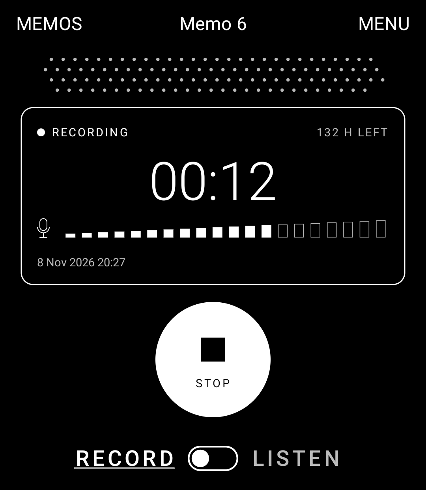
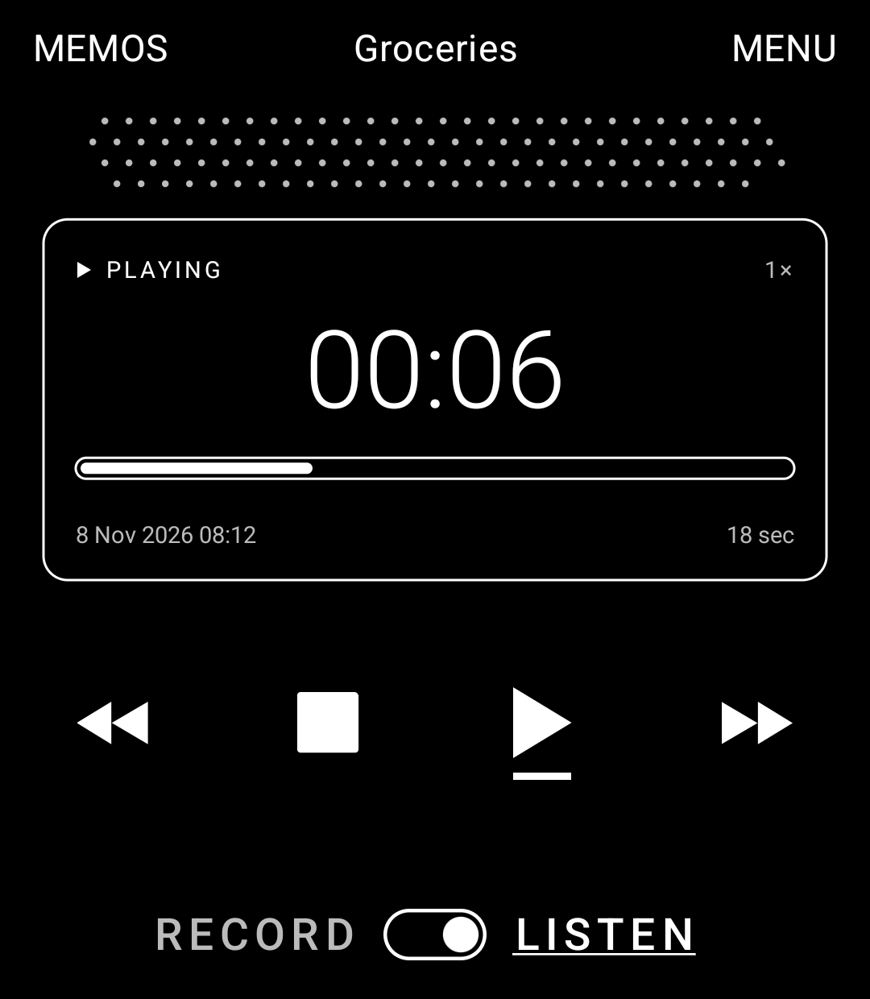
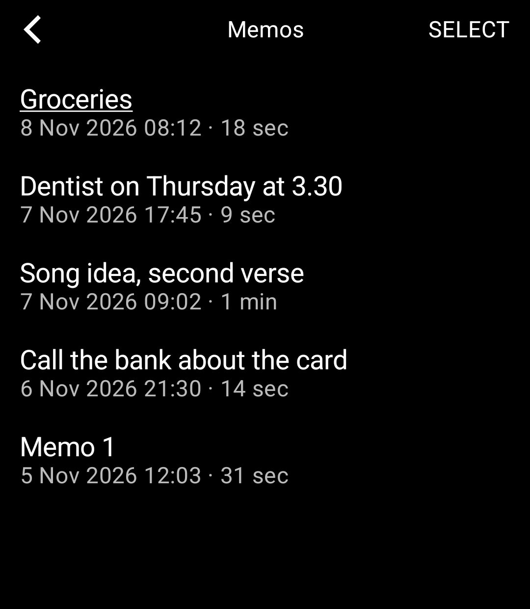

# Memo

A pocket memo recorder for the Light Phone III, built with the [Light SDK](https://github.com/lightphone/light-sdk) by
Slow Pixels. It's the Light Phone's version of Memo for the Mudita Kompakt, redrawn in Light's line-and-type look.

<p>
  
  
  
</p>

The face of a 90s voice recorder: a speaker grille of round holes, a display window with a counter, and a slide switch
along the foot that sets the mode, as on some pocket recorders. **Record** on the left, **Listen** on the right. Moving
the switch never starts anything.

- **Record:** one big key, on or off. Off, it's a ring with a dot in it. A press starts a memo, and the key turns solid,
  with a square and STOP: the one solid shape on the screen, only while recording, so on and off can't be confused. The
  next press stops and keeps the memo, and the display says "Memo 6 saved". Under a second is "Too short to keep" and
  gives its number back; numbers are otherwise never reused. The display shows the counter, a level meter of twenty
  cells that fill as the mic hears, and how many hours of room the phone has left.
- **Listen:** one memo on the deck. ▶ plays it from where it stands (with a line under it while it plays, as a deck's
  play key stays down), ■ stops it there. ◀◀ ▶▶ skip 5 s while playing (held: 15 s steps, then a minute); while stopped,
  ◀◀ goes to the start, then the memo before, ▶▶ to the memo after. Touch or slide along the bar to move through the
  memo. The title at the top opens the memo's page: rename (on Light's keyboard) or erase.
- **Memos** lists them all, newest first; a tap plays one. SELECT erases several at once, after asking.
- **Play speed**, in the menu, from 0.5× to 2×, and **at other speeds**: *keep pitch* (a memo sounds like itself) or
  *like tape* (slower is lower, faster is higher: 0.5× is an octave down, 2× an octave up). Android makes a pitch by
  playing the sound at another rate, so a pitch equal to the speed is exactly tape's sound; on the simulator the mixer
  shows a 48 kHz memo going out at 96 kHz at 2×.

## How it fits LightOS

- **The mic only works while Memo is on screen.** Light lets a tool keep playing sound in the background, but not use
  the microphone there, so the screen stays on while recording, and leaving Memo (Home, the side button, a call) stops
  the memo and keeps it. The display says so when you come back. The top bar's MEMOS and MENU wait until recording
  stops, so a stray tap can't end a memo; the mode switch does stop and keep it, as sliding a recorder off REC does.
- **Listening goes on with the phone locked**, and the lock screen's play and pause work it. A tool can't ask Android
  for audio focus or a background service itself, so `audio/Holder.kt` keeps Light's own player (the `detached-audio`
  capability) playing a minute of silence on a loop, and the deck follows it: music pauses while you record or listen,
  a call stops you, and the lock screen's ▶ plays the memo on the deck. Backing out of the tool stops everything.
  Taking off headphones while a memo plays stops it, rather than playing on out loud.
- **Memos are plain sound files** in the tool's shared folder, which **Light's Tool Manager** shows in a browser on a
  computer (the `tool-manager-provider` capability): copy memos off the phone, or put sound files on it and they join
  the list. The folder can be included in Light's backups.
- Screens are Light's kit: `LightTopBar`, Light's icons for the transport, chosen rows underlined as Light's own
  settings do, Light's keyboard for names, and Light's permission screen for the mic.

## How it records

`audio/Recorder.kt` reads the mic (`AudioRecord`, the ordinary voice source) on a thread of its own and hands it to
Android's AAC encoder: mono, 48 kHz, 96 kbit/s, about 43 MB an hour. Each encoded frame is written with its own ADTS
header (`audio/Adts.kt`), so a file stands on its own however it ends: if the phone dies mid-memo, everything up to
then plays, and the next start cuts off a frame left half written and keeps the rest. Frames reach the file about once
a second. The memo's length is counted in samples taken from the mic, so the counter and the file agree.

`deck/Deck.kt` is the machine, carried over from the Kompakt app: the two modes, the one key, the transport, the meter
(up at once, down a cell at a time), and Android's `MediaPlayer` for playing, which is what can set a speed and a pitch
apart. `store/Memos.kt` keeps the list (numbers, names, lengths) in a small JSON file beside the tool's own files,
written to a new file and moved over the old one so a full phone keeps the old list; the folder is the truth. File names
sort by date on a computer: `2026-11-08 14.41.07 Groceries.aac`, renamed with the memo.

## Privacy

It asks for the microphone and nothing else, and can't reach the internet (`lighttool.toml` asks only for
`RECORD_AUDIO`). Memos stay on the phone until you copy them off with the Tool Manager or turn on Light's backups for it.

## Building

This is a copy of Light's SDK (commit 2f02ecd) with the tool in `tool/`. Build it as any Light tool:

```bash
./gradlew :tool:installDebug
```

To run it on the LightOS emulator, see [the emulator guide](docs/system_app/README.md). The tests (the memo list, the
ADTS frames, the deck's arithmetic and the words on the display):

```bash
./gradlew :tool:testDebugUnitTest
```

The emulator's microphone hears nothing. In a debug build, a file `test-feed.pcm` (raw mono 16-bit 48 kHz) in the tool's
own files folder is read in place of the mic, at the pace a mic gives it:

```bash
adb push test-feed.pcm /data/local/tmp/ && adb shell run-as com.slowpixels.memo cp /data/local/tmp/test-feed.pcm files/
```

## Licence

MIT, as the SDK is. See [LICENSE](LICENSE) for the SDK and [LICENSE-MEMO](LICENSE-MEMO) for the code in `tool/`.
